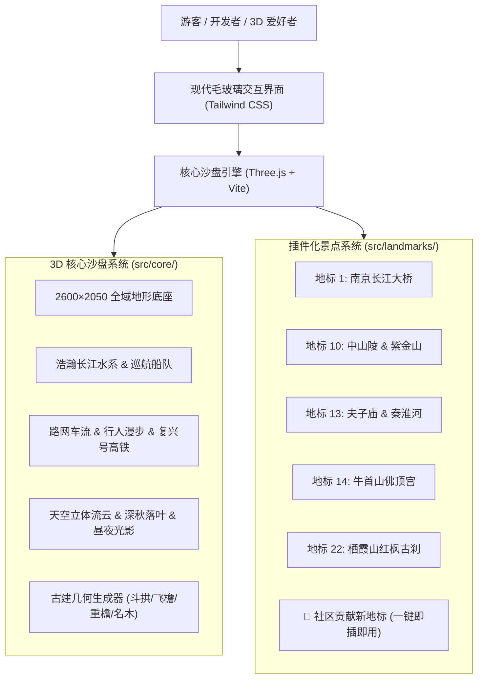

<div align="center">

# 🏯 Open Nanjing 3D (南京全域景点 3D 数字沙盘)

### 汇聚全球开发者与 3D 爱好者，共建六朝古都高拟真数字孪生沙盘地图与文旅导览系统
**A Community-Driven 3D Digital Sand Table & Tour Guide for Nanjing Landmarks**

[](LICENSE)
[](https://threejs.org/)
[](https://vitejs.dev/)
[](CONTRIBUTING.md)
[](LANDMARKS_WISHLIST.md)
[](https://github.com/yuhangwu97/open-nanjing-3d)

[🌐 在线演示 (Live Demo)](https://yuhangwu97.github.io/open-nanjing-3d/) · [🏛️ 认领新景点 (Wishlist)](LANDMARKS_WISHLIST.md) · [🤝 贡献指南 (Contributing)](CONTRIBUTING.md) · [🐛 报告问题 (Issues)](https://github.com/yuhangwu97/open-nanjing-3d/issues)

</div>

---

## 🌟 项目简介 (Overview)

**Open Nanjing 3D** 是由 [@yuhangwu97](https://github.com/yuhangwu97) 发起的完全开源项目，致力于利用 WebGL 与现代前端工程，构建覆盖**南京全域 11 个行政区**的 3D 高拟真数字孪生沙盘与互动文旅导览系统。

项目目前已实现 **22 大核心地标** 的高精度 3D 几何建模、全域水系交通与攻略数据库，并设计了**解耦插拔式的“景点插件架构”**，任何人只需一个 JS 文件或一个 `.glb` 3D 模型即可为南京新增一座景点！



---

## ✨ 核心特色 (Key Features)

- 🏛️ **22 大金陵地标高拟真重塑**：
  从**南京长江大桥**双层公铁与红旗桥头堡、**中山陵**博爱坊与祭堂、**明孝陵**石象路神道、**美龄宫**航拍梧桐宝石项链，到扎哈·哈迪德**青奥双塔与南京眼**、**450米紫峰大厦**、**牛首山佛顶宫**双曲天幕与摩尼宝珠、**栖霞山**420+棵漫山红枫古刹。
- 🚶 **第一人称 392 级登陵漫游**：
  国内首创 3D 第一人称漫步模式，真实还原从中正路、博爱坊、陵门、碑亭直至祭堂攀登 392 级台阶的微观视角与历史讲解。
- 🍂 **四季与“金陵璀璨夜景”光影模式**：
  支持一键切换【深秋金陵】（满城梧桐银杏金黄、秋叶漫天飘落）、【盛夏绿意】与【金陵璀璨夜景】（秦淮两岸暖橙灯火、大桥玉兰花路灯、紫峰大厦宝石蓝自发光、南站金顶）。
- 🚄 **全域生动动态交通体系**：
  半圆弧长江巡航豪华游轮与集装箱船队、南京南站进出站复兴号高铁、禄口机场起降客机、全城主干道公交车与街道漫步人群。
- 🧭 **5 条特色旅游攻略路线**：
  空铁枢纽名山线、钟山文博线、河西滨江线、历史祈福线、夜泊秦淮线，带 3D 动态发光流光管道指引。
- 🔌 **零门槛开源共建机制**：
  解耦的模块化设计，提供脚手架命令 `npm run new:landmark`，支持原生 Three.js 参数化代码或导入 Blender `.glb` 3D 模型！

---

## 🏛️ 已收录的 22 大地标 (Implemented Landmarks)

| 编号 | 景点名称 | 坐标中心 (X, Z) | 标志性看点 |
| :---: | :--- | :---: | :--- |
| **01** | **南京长江大桥** | `(-145, -315)` | 双层公铁两用大桥、70米大桥头堡三面红旗、24对玉兰花灯 |
| **02** | **南京长江五桥 & 江心洲** | `(-382, 215)` | 世界首座轻型钢混组合三塔斜拉桥、江心洲柳叶绿岛 |
| **03** | **鱼嘴湿地公园** | `(-255, 365)` | 三水交汇处红白江边灯塔、滨江木栈道日落机位 |
| **04** | **南京奥体中心** | `(-155, 30)` | 6万座主体育场双世界最大跨度红色斜拱、游泳馆与科技主轴 |
| **05** | **青奥双塔 & 南京眼步行桥** | `(-155, 165)` | 扎哈流线双子塔、羽毛形保利剧院裙楼、双环穿行斜拉步行桥 |
| **06** | **侵华日军南京大屠杀遇难同胞纪念馆** | `(-142, -68)` | 和平女神雕像、灰色清水混凝土断垣残壁、和平长明火与鹅卵石旷野 |
| **07** | **古鸡鸣寺 · 药师佛塔** | `(105, -245)` | 南朝第一寺、鸡笼山巅七层八角明黄药师佛塔、樱花大道 |
| **08** | **玄武湖景区 & 明城墙** | `(225, -165)` | 环洲/樱洲/梁洲/翠洲/菱洲五洲绿岛、台城解放门明城墙、湖心游船 |
| **09** | **明孝陵 · 石象路 & 方城明楼** | `(395, -14)` | 皇家神道十二对精雕石兽、文武方门、金水桥、方城明楼 |
| **10** | **中山陵 & 紫金山风景区** | `(525, -118)` | 392级花岗岩石阶、博爱坊、陵门、祭堂蓝色琉璃瓦屋面 |
| **11** | **美龄宫 · 梧桐宝石项链** | `(545, 82)` | 俯瞰梧桐环抱的巨型翡翠绿宝石项链、深翠琉璃官邸 |
| **12** | **南京博物院** | `(395, 165)` | 1:1严格还原原国立中央博物院辽金木构老大殿与曲面艺术馆 |
| **13** | **夫子庙 · 十里秦淮 & 天下文枢** | `(145, 195)` | 66米天下文枢大广场、双龙戏珠大照壁、大成殿、秦淮画舫游船 |
| **14** | **牛首山 · 佛顶宫 & 佛顶塔** | `(205, 545)` | 120米黄金袈裟天幕、摩尼宝珠圆穹顶、九层佛顶古塔、隐龙湖 |
| **15** | **紫峰大厦 & 鼓楼** | `(265, 85)` | 450米蓝宝石弧面双三角束筒、晶莹玻璃幕墙与明代鼓楼古刹古今同框 |
| **16** | **南京南站** | `(0, 365)` | 亚洲最大高铁枢纽：双重檐京派大挑檐金顶、南北广场与复兴号高铁 |
| **17** | **南京青奥体育馆 (江北新区)** | `(-635, 95)` | 亚洲最大室内馆之一：“江鸥展翅”流线双曲金属屋盖、青奥体育公园 |
| **18** | **南京城墙 · 中华门瓮城** | `(-10, 215)` | 天下第一瓮城：四道券门、三道瓮城、27座藏兵洞与跨河长干桥 |
| **19** | **南京老山国家森林公园** | `(-820, -60)` | 南京绿肺百里苍翠翠峦、主峰大刺山五层八角飞檐森林状元观景塔 |
| **20** | **江宁方山 (平顶火山 · 定林寺斜塔)** | `(455, 405)` | 平顶茶园火山台地、白色气象雷达圆顶、依山定林寺与 7.59°斜塔 |
| **21** | **南京禄口国际机场 (T1/T2)** | `(-315, 620)` | 展翼双曲金属双航站楼、空管塔台雷达与 4F 双跑道起降客机 |
| **22** | **栖霞山 · 栖霞古寺 & 隋代舍利塔** | `(790, -395)` | 420+棵满山红枫层林尽染、千年栖霞寺、五级八角隋代白石舍利塔 |

> 想要认领新景点？请查看 **[🏛️ 南京全域地标认领英雄榜 (LANDMARKS_WISHLIST.md)](LANDMARKS_WISHLIST.md)**（总统府、阅江楼、大报恩寺、灵谷寺等 60+ 待建景点等你认领！）

---

## 🚀 快速开始 (Quick Start)

### 环境要求
- [Node.js](https://nodejs.org/) v18.0.0 或更高版本
- 现代支持 WebGL 2.0 的浏览器 (Chrome / Edge / Safari / Firefox)

### 安装与运行
```bash
# 1. 克隆代码仓库
git clone https://github.com/yuhangwu97/open-nanjing-3d.git
cd open-nanjing-3d

# 2. 安装依赖包
npm install

# 3. 启动本地开发服务 (带热重载)
npm run dev

# 4. 构建生产包 (自动输出到 dist/ 目录)
npm run build
```

---

## 🛠️ 一键新建景点脚手架 (Scaffolding Tool)

我们编写了开箱即用的命令行工具，帮助你 3 秒生成规范的景点模版：

```bash
# 用法: npm run new:landmark <景点名称> [英文标识]
npm run new:landmark "阅江楼" yuejiang_tower
```

执行后将自动生成 `src/landmarks/yuejiang_tower.js`，包含标准的基座、主体、中式飞檐与动画注册骨架。

---

## 🤝 参与贡献 (Contributing)

我们非常欢迎不同领域的贡献者：
1. **3D 代码开发者**：利用项目内置的古建构件工具（斗拱、飞檐、重檐、琉璃瓦等）使用 Three.js 参数化代码建模。
2. **3D 建模师 (Blender / C4D)**：制作轻量化 `.glb` 模型（控制在 3MB 内）放置于 `public/models/`。
3. **文旅与摄影达人**：丰富 `src/data/spots.js` 的门票时段、避坑攻略与最佳拍摄机位，或在 `src/data/routes.js` 策划特色主题路线。

详细规范请参阅 **[🤝 完整贡献者指南 (CONTRIBUTING.md)](CONTRIBUTING.md)**。

---

## 🧰 技术栈 (Tech Stack)

- **3D 渲染引擎**：[Three.js](https://threejs.org/) (r160)
- **构建工具**：[Vite](https://vitejs.dev/) 6.x
- **UI 样式设计**：[Tailwind CSS](https://tailwindcss.com/)
- **工作流与部署**：GitHub Actions + GitHub Pages
- **编程语言**：现代标准 JavaScript (ES Modules)

---

## 📄 开源协议 (License)

本项目基于 [MIT 协议](LICENSE) 开源。欢迎个人学习、非商业文旅宣传与开源二创，使用时请保留原作者信息。

---

<div align="center">
  <b>金陵一梦三千里，六朝烟雨入画来。</b><br>
  Designed & Maintained with ❤️ by <a href="https://github.com/yuhangwu97">@yuhangwu97</a> & Community Contributors.
</div>
